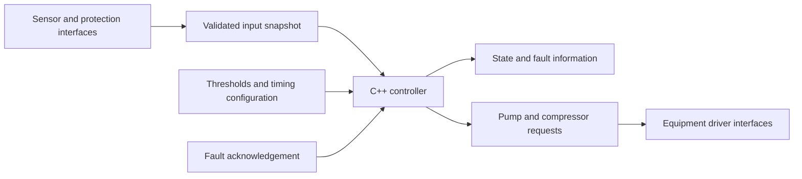
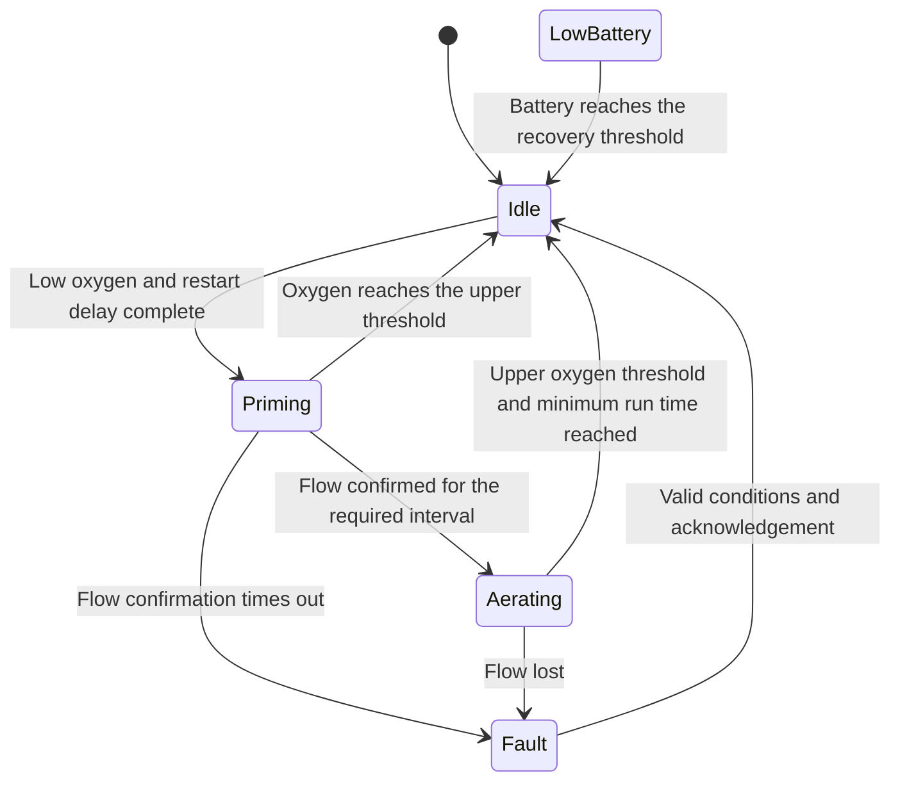

# Bubbleoxy

Bubbleoxy is a prototype control software project for a solar-powered, floating water oxygenation system. It develops the decisions that coordinate a water pump and an air compressor using dissolved oxygen measurements, battery state of charge, flow feedback, and fault signals.

The current implementation is a hardware-independent **C++11 control core** supported by a scripted simulation and automated tests. Its purpose is to make the control behavior explicit and testable before physical prototype integration. Sensor drivers, electrical interfaces, and remote monitoring remain to be developed.

## Relationship to the physical system

The proposed physical system combines water circulation, air supply, a venturi section, a nozzle, and diffuser outlets. The software controls when the pump and compressor are requested to operate. It receives feedback about water conditions and equipment operation through an input snapshot.

The controller does not calculate bubble size or model oxygen transfer. Nano-bubble generation, oxygen distribution, and treatment effectiveness require separate physical measurements. Likewise, the solar-powered concept does not mean that this software implements charging control or guarantees continuous operation from solar energy.

The initial equipment sequence assumes that water circulation should be established before the compressor starts. This sequence, its timing, and the simultaneous shutdown behavior must be checked against the selected equipment.

## Software architecture

The implementation separates decision-making from the future hardware interfaces:

The controller and its data structures are implemented. The sensor, protection, and equipment driver interfaces in this diagram are integration boundaries, not completed drivers.

| Element | Role |
| --- | --- |
| `Config` | Defines oxygen thresholds, battery thresholds, and timing limits. |
| `Input` | Supplies measurements, validity, flow feedback, an emergency flag, and a timestamp. |
| `Controller::tick()` | Evaluates one control cycle and returns the current decision. |
| `Output` | Reports the operating state, fault reason, and two Boolean equipment requests. |
| `State` | Represents the current operating phase. |
| `Fault` | Identifies the first latched fault. |

The core has no GPIO assignments, Arduino dependencies, network calls, or blocking delays. It is intended to be reusable inside a future Arduino or ESP32 application, but has not yet been compiled with an Arduino toolchain or validated on a physical board. Equipment outputs are on/off requests; speed regulation is not implemented.

## State machine

The control algorithm is a finite-state machine. Each state determines which equipment may be requested to operate and which transitions are possible.

| State | Pump request | Compressor request | Meaning |
| --- | --- | --- | --- |
| `Idle` | Off | Off | Waiting for low oxygen and completion of the restart delay. |
| `Priming` | On | Off | Establishing and checking water flow. |
| `Aerating` | On | On | Operating both devices while monitoring conditions. |
| `LowBattery` | Off | Off | Waiting for sufficient battery recovery. |
| `Fault` | Off | Off | Holding equipment off until the fault can be acknowledged. |

The normal operating sequence is:

The diagram shows the main operating transitions. Global checks can also move any non-fault state to `Fault` for invalid configuration, an emergency, or invalid sensor data. Low battery moves normal operating states to `LowBattery`; it does not clear a latched fault.

## Decision priority

Every call to `tick()` evaluates conditions in this order:

1. **Configuration validity.** Invalid thresholds or timing settings produce a configuration fault.
2. **Emergency input.** An asserted emergency flag produces an emergency fault.
3. **Measurement validity and age.** Invalid or stale data produces a sensor fault.
4. **Existing fault.** The controller remains off unless acknowledgement is accepted.
5. **Battery condition.** Low charge stops equipment; recovery uses a separate threshold.
6. **Normal state logic.** Oxygen demand, flow confirmation, and operating timers determine the next state.

This order means that an equipment protection condition can stop operation without waiting for the normal minimum run time. A fault acknowledgement cannot bypass an active emergency, invalid configuration, or invalid measurement.

## Dissolved oxygen control

Oxygen demand uses **hysteresis**, with different thresholds for starting and stopping:

- In `Idle`, oxygen at or below `oxygenStart` permits a start once the restart delay has elapsed.
- In `Aerating`, oxygen at or above `oxygenStop` permits a normal stop once the minimum run time has elapsed.
- Between the thresholds, an idle controller stays idle and an aerating controller keeps operating, provided no higher-priority condition intervenes.

This prevents a single switching threshold from repeatedly starting and stopping equipment when measurements fluctuate around it. It does not filter sensor noise or validate the physical accuracy of the oxygen reading.

If oxygen reaches the upper threshold during `Priming`, the controller cancels the start and returns to `Idle`. The compressor is not enabled in that case.

The current algorithm is threshold-based on/off control. It does not use PID, predictive control, or a model of the relationship between equipment power and dissolved oxygen.

## Pump startup and flow confirmation

Entering `Priming` requests the pump on while keeping the compressor off. The controller then observes the Boolean `flow` input.

The first positive flow observation starts a confirmation timer. If a later observation reports no flow, that timer is reset. The compressor is enabled only after positive observations have persisted for at least `flowStableMs`.

If flow has not qualified when the startup timeout is evaluated, the controller latches `Fault::NoFlow` and switches both requests off. In the current branch order, successful flow confirmation takes precedence if confirmation and timeout are both reached in the same cycle. Oxygen recovery is checked before either condition.

Once in `Aerating`, a negative flow observation immediately produces a no-flow fault on that control cycle. There is no running flow-loss grace period or automatic retry.

“Stable flow” here means stability across observed input snapshots. The core cannot detect a short interruption that occurs entirely between snapshots. Detecting those interruptions, defining an acceptable physical flow rate, and handling a stuck flow sensor belong to the hardware integration layer.

## Battery management

The controller consumes battery **state of charge (SOC)** as a percentage. It does not convert voltage to SOC or control battery charging.

When SOC is at or below `batteryStop`, normal operation moves to `LowBattery` and both equipment requests turn off. This overrides the minimum run time. The controller remains in that state until SOC reaches or exceeds `batteryResume`.

Recovery returns the controller to `Idle` without starting equipment in the same cycle. Subsequent cycles still require low oxygen and an elapsed restart delay. The recovery transition does not restart that delay; time already spent stopped can satisfy it.

A low-battery pause is recoverable without operator acknowledgement. A latched fault still requires acknowledgement even if the battery has recovered.

## Measurement validation

The input snapshot contains the following fields:

| Field | Meaning and requirement |
| --- | --- |
| `oxygenMgL` | Dissolved oxygen in mg/L; must be finite and nonnegative. |
| `batterySoc` | Battery SOC; must be finite and within 0–100%. |
| `valid` | Must indicate that all required measurements are usable. |
| `flow` | Boolean indication that the required water flow is present. |
| `emergency` | Aggregated equipment protection or emergency-stop signal. |
| `sampledAtMs` | Timestamp of the coherent measurement snapshot, using the controller's clock. |

A sample is accepted only if its age is no greater than `maxSampleAgeMs`. A sample exactly at that age limit is accepted; an older sample produces a sensor fault.

The integration layer must not refresh the timestamp while reusing failed or stale measurements. Sensors sampled at different rates need individual freshness checks before a coherent snapshot is declared valid.

The core checks numeric validity and basic ranges. Sensor-specific oxygen limits, calibration, temperature and salinity compensation, fouling detection, filtering, and detection of plausible but stuck values are not implemented.

## Fault handling and acknowledgement

| Fault | Trigger |
| --- | --- |
| `Configuration` | Invalid thresholds or timing configuration. |
| `Sensor` | Invalid snapshot, invalid numeric values, out-of-range SOC, or stale data. |
| `Emergency` | The external emergency flag is asserted. |
| `NoFlow` | Startup flow confirmation fails or flow is lost during aeration. |

The first fault is retained while the controller stays in `Fault`. Later conditions do not overwrite that reason. This preserves the original trigger, but the output is not a record of every active fault.

Acknowledgement is accepted only after the configuration, emergency, and measurement checks pass. It clears the stored fault, returns to `Idle`, and starts a new minimum off interval. Both equipment requests remain off in that cycle. The acknowledgement input is intended to represent an explicit operator action; its button or command interface has not been implemented.

A no-flow fault may be acknowledged while flow is absent because the pump is off. The next start must establish flow again. Acknowledgement therefore permits another attempt; it does not prove that the underlying flow problem has been repaired.

Fault state and history are held in memory only. Recreating the controller after a restart loses that history and begins with equipment off and an initial wait interval.

## Timing and configuration

All timing uses unsigned 32-bit millisecond timestamps. The controller compares elapsed time rather than waiting inside a control cycle. Regular calls allow flow, battery, and emergency conditions to be reevaluated while operating timers are active.

| Parameter | Current illustrative default | Purpose |
| --- | --- | --- |
| `oxygenStart` | 4.0 mg/L | Start threshold. |
| `oxygenStop` | 6.0 mg/L | Normal stop threshold. |
| `batteryStop` | 20% SOC | Low-battery stop threshold. |
| `batteryResume` | 35% SOC | Battery recovery threshold. |
| `maxSampleAgeMs` | 3,000 ms | Maximum accepted sample age. |
| `primeTimeoutMs` | 5,000 ms | Startup flow-confirmation timeout. |
| `flowStableMs` | 1,000 ms | Required observed flow-confirmation interval. |
| `minRunMs` | 10,000 ms | Minimum aeration time before a normal oxygen-based stop. |
| `minOffMs` | 5,000 ms | Initial and restart waiting interval. |

**These are simulation examples, not validated operating settings.** Appropriate values depend on the selected equipment, sensor behavior, battery system, and experimental results.

The minimum run timer starts when the compressor is enabled in `Aerating`. The off interval is enforced before starting from `Idle`, including on initial startup and after fault acknowledgement. Faults and low battery bypass the minimum run requirement.

Configuration validation requires ordered oxygen and battery thresholds, valid numeric values, positive sample-age and flow-confirmation limits, and a startup timeout longer than the flow-confirmation interval. Timing limits are kept below half the unsigned counter range. Zero minimum run or off intervals are allowed.

Unsigned subtraction supports ordinary timer rollover, provided timestamps share the same clock and the controller is serviced regularly. It does not make arbitrarily old samples safe or compensate for a blocked control loop. Actual response time includes the interval between calls, sensor latency, and equipment driver latency; no scheduler or hardware watchdog is implemented in the core.

## Simulation and verification

The scripted simulator supplies predetermined oxygen, SOC, and flow values. Its sequence shows initial waiting, pump startup, flow confirmation, aeration, normal oxygen-based shutdown, a low-battery pause, and recovery. It reports time, inputs, state, fault, and equipment requests as CSV data.

This simulation exercises the controller's decisions. It is not a model of water chemistry, bubble formation, pump hydraulics, solar generation, or battery discharge.

Automated tests cover startup delay, threshold boundaries, oxygen and battery hysteresis, minimum run time, restart delay, interrupted flow confirmation, startup timeout, flow loss during operation, emergency shutdown, invalid and stale measurements, fault acknowledgement, invalid configuration, and timestamp rollover. The current implementation has passed desktop compilation and its automated tests. Physical equipment behavior remains unverified.

The GitHub workflow is configured to compile and test the code on pushes and pull requests. Desktop tests establish behavior for the tested input sequences; they do not establish field reliability or oxygenation effectiveness.

## Source organization

| File | Responsibility |
| --- | --- |
| `src/bubbleoxy.h` | C++11 data structures, state machine, validation, timing, and output decisions. |
| `examples/simulator.cpp` | Scripted input sequence and readable decision trace. |
| `tests/controller_tests.cpp` | Behavioral checks for normal operation and fault conditions. |
| `CMakeLists.txt` | Desktop build and test configuration. |
| `.github/workflows/ci.yml` | Automated build and test workflow. |
| `docs/ALGORITHM.md` | Additional algorithm notes in Turkish. |
| `docs/HARDWARE.md` | Hardware integration notes in Turkish. |

## Remaining prototype work

Hardware integration must supply calibrated measurements, coherent timestamps, equipment protection signals, and correctly mapped actuator outputs. Physical output defaults during boot, reset, and power loss must be addressed in the electrical design and driver layer.

Further development includes sensor drivers, battery/BMS integration, equipment-specific startup and shutdown sequences, persistent event logging, and communications. Telemetry, remote commands, authentication, firmware updates, and coordination between multiple floating units are not yet implemented.

The control core currently makes local decisions without a network dependency. Future communications should preserve that local decision path and must not bypass equipment protection checks. Tank experiments will be needed to select operating thresholds, validate flow and pressure conditions, measure energy demand, and evaluate oxygen transfer independently of the software tests.
